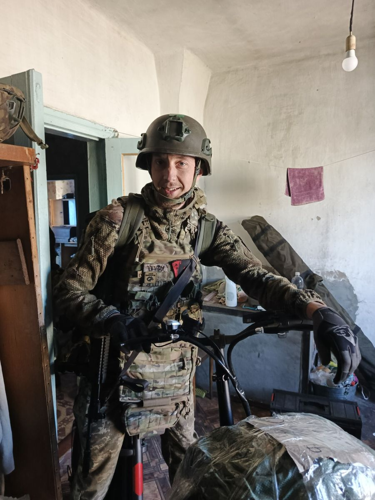

# E-bikes experiment

It was a battlefield of drones, and finding any edge—no matter how unconventional—meant a better chance of keeping people alive. So the idea made sense on paper: quiet electric bikes, bought out of pocket, moving fast enough to dodge trouble while staying off the radar.

Reality on the ground, however, has a way of complicating good theory. A bike rated for 20 km/h acts very differently when you’re not just carrying your own weight and body armor, but also slinging critical supplies across your back and holding extra gear in one hand.

The picture captured that exact tension. Your teammate standing there, visibly unenthusiastic about the camera, muttering the dark humor endemic to the front: "Don't take that picture. What if it's my last one?"

The very next day brought its own reality check. Riding along with a full load—water packed heavy in your backpack and equipment clamped in your left hand—a sharp, sudden sound cut through the air behind you. In a war dominated by FPV drones, that sound demands an instant reaction. You snapped your head back to check the sky, lost control in the split second of distraction, and hit the dirt face-first.

In the end, the e-bikes did their job for a short window. They moved supplies when they needed to. But the battlefield is unforgiving to delicate gear, and the bikes were eventually abandoned for more reliable means.

What remains is that quiet snapshot—a testament to constant adaptation, trial and error under pressure, and the absurd, dangerous moments that define life on the line.

## Images

