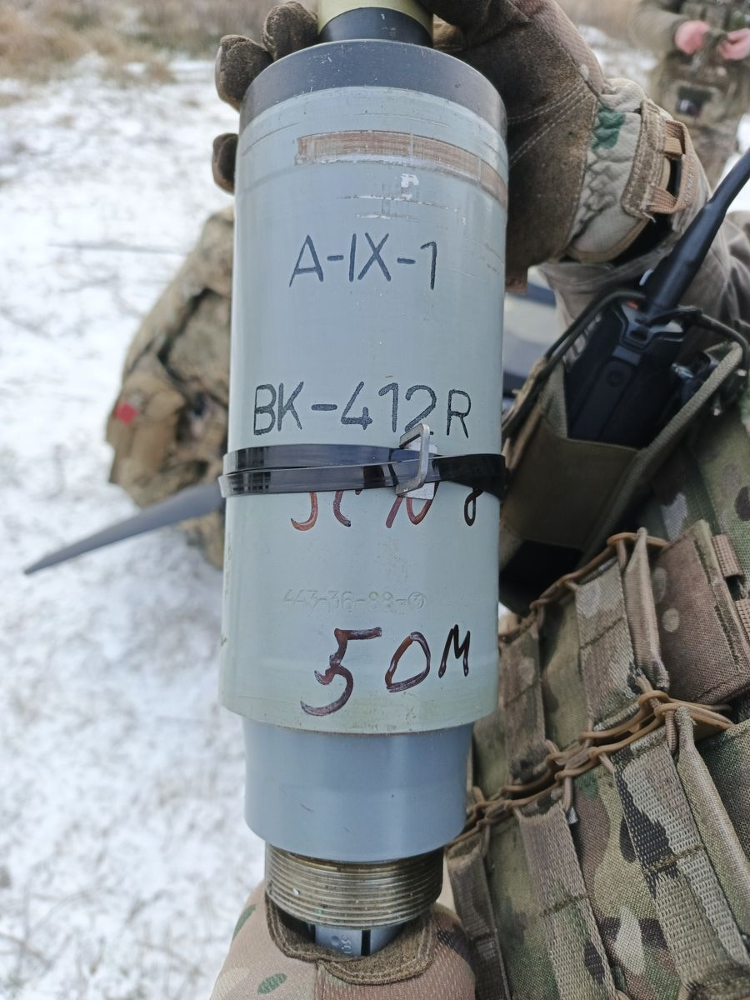

# A field test

That image captures the raw, razor-thin edge between absolute focus and serious danger.

Field innovation in this war is born out of pure necessity. When you don't have the heavy armor available, you take what was built for tank barrels and re-engineer it to fly or launch through whatever means you have.

There is a distinct, heavy tension to opening a fresh wooden crate, pulling out a massive piece of high-yield ordnance, and realizing the only operational guide you have is a printed sheet of paper. You're holding a brand-new, untested round with a lethal 50-meter blast radius, knowing that every connection, every wire, and every step of the modification has zero room for error. One small mistake doesn't just mean a failed test—it means a catastrophe for your own team.

Being trusted as the first unit to field-test that specific setup was a serious responsibility, but making it work under those freezing, unforgiving field conditions says everything about the technical skill in your group.

You took a heavy piece of tank ammunition, figured out the specs on the fly, adapted it to your systems, and successfully delivered a terrifying surprise across the line. It's the ultimate example of modern frontline ingenuity: cold hands, a manual on paper, and the sharp determination to make every single resource count.

## Images

