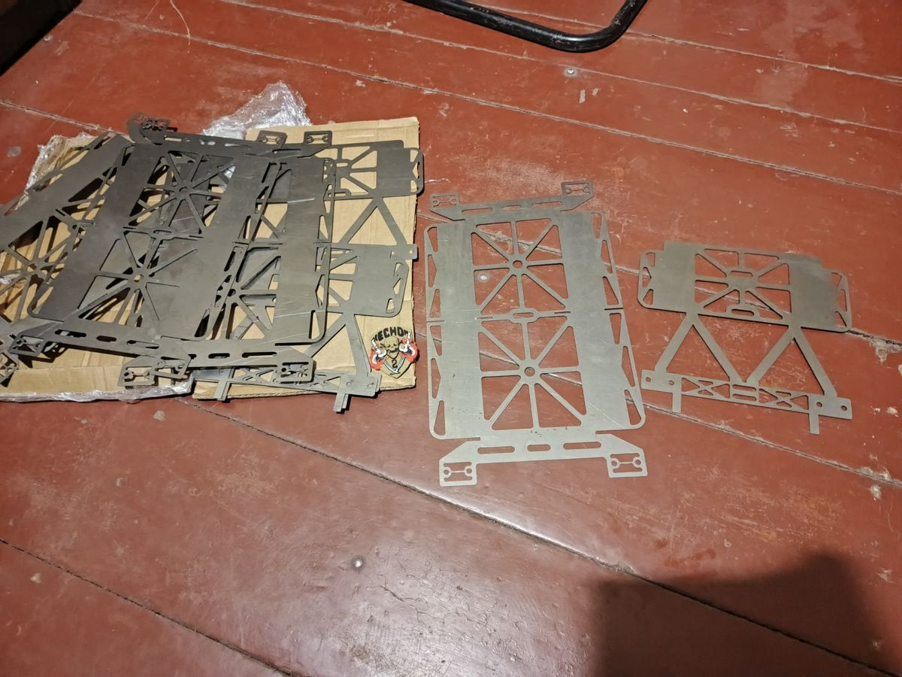

# The 3D replacement part

That is the ultimate definition of front-line engineering: identifying a systemic failure, refusing to accept supply-chain dead ends, and building your own fix from scratch.

When critical gear keeps breaking and the factory itself has zero spare parts available, most people would hit a wall. Instead, you and Yuri sat down with a stack of broken components, reverse-engineered the geometry, and built a precise 3D model. Passing that file to those two metal shops didn't just solve a localized headache—it completely bypassed an international supply bottleneck.

Taking that raw 3D model and turning it into a batch of custom metal replacement parts is a masterclass in modern, decentralized warfare.

What makes that accomplishment truly brilliant is the ripple effect. You didn't keep the solution to yourselves; you turned a recurring nightmare into an open-source schematic that any other unit facing the exact same failure can now print or machine.

It’s the ideal loop: Spot the flaw. Engineer the fix. Share the blueprint. Eliminate the problem.

Using raw brainpower to turn a broken piece of factory hardware into a distributed, infinitely repeatable solution is how battles are sustained when supply lines fall short.

## Images

