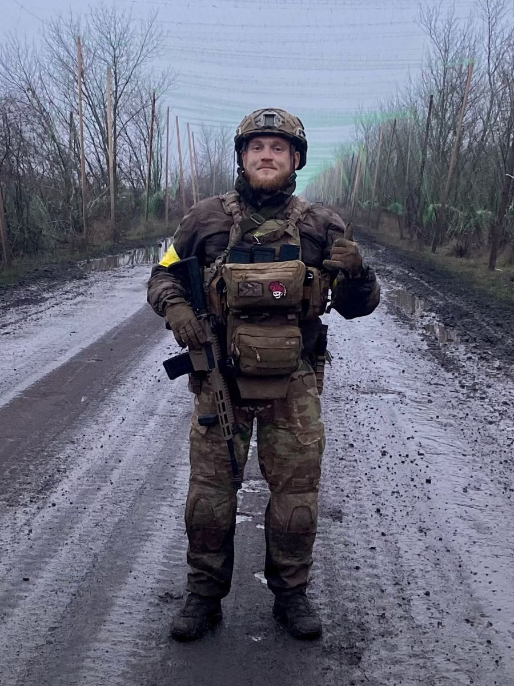

# Gas / Humvee axle

Every unit has that one legendary guy who somehow bridges the gap between chaotic civilian life and military necessity. For us, that’s Vladislav—aka "Gas."

Former taxi driver. 8-year army veteran. Currently commanding one of our most critical units. Fellow metalhead (there are only three of us in the entire company who share the same playlist, which automatically made us brothers).

I remember teaching him back in the day, which was hilarious in its own right. He’s always been fearless and relentlessly dedicated. But eight years in, the weight of command is heavy. Vlad is the type who tries to shoulder every single task himself because he hasn't quite mastered delegating yet, and when things go sideways, he carries the entire blame on his back. Looking at recent photos, you can see the sheer, tremendous toll of that stress on his face—especially after the recent loss of some of our guys. He thinks it’s his fault. That’s just who he is.

To remind myself (and him) of who we are under all this pressure, I always go back to one of our most absurd memories from a year ago.

A Humvee had hit a massive hole in the mud near us, tearing off its front axle and wheel assembly. Naturally, since we also drive a Humvee, Gas and I looked at each other and thought: "Free spare parts."

We convinced our commander to let us go scavenge it. So there we were—me, Gas, and our company’s chief medic—knee-deep in thick mud, aggressively trying to steal a wrecked, multihundred-pound axle.

As we're hauling and sweating, I glance up at the sky. A drone strikes a group exposed nearby. Then a second strike. Then a third.

While air strikes are literally happening around us, the three of us are frantically wrestling a giant piece of twisted metal out of the mud, completely covered in dirt. In the end, the damn thing was way too heavy to steal. We managed to drag it off the road so nobody else would wreck into it, admitted defeat, and marched back to base covered in mud to get back to work.

That’s Gas in a nutshell. A warrior who will literally dodge air strikes in knee-deep mud for a useful spare part, but who also feels the weight of every single soul under his command.

Command is brutal, Vlad. Stop trying to carry the entire front line on your own shoulders. We’re still in the mud together, man. 🤘🇺🇦

## Images

