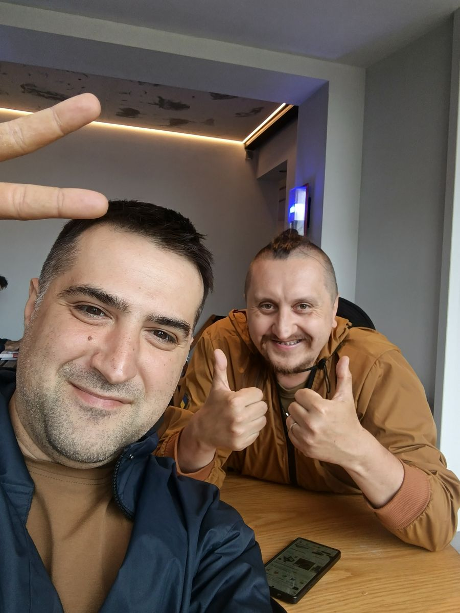

# Rostislav / volunteer tech

Meeting someone like Rostislav in person after working together remotely for over a year is one of those rare, genuinely grounding moments.

He’s bright, relentless, and shares that same tech background where you just look at a problem and immediately want to build a solution. The guy literally built a lab in his own home using his own money, scavenging and repurposing old electronics to craft gear that keeps us running on the front.

A year ago, we started with a simple, hands-on idea: building custom single-use power banks. We started small, iterated, and kept scaling it up. Eventually, incredible volunteer networks like the Wild Bees stepped in to solve part of that supply puzzle—which is the magic of this ecosystem. Volunteers don't just fill gaps; they innovate until whole communities take up the mantle.

But beyond the gear, the power banks, and the tech, meeting Rostislav highlighted something much bigger. It’s not just about what volunteers give us—it’s the mutual feedback loop of energy.

When you’re in the field, knowing guys like him are pulling all-nighters in home labs keeps you going. And seeing their work save lives and power operations gives them the fuel to keep building. It’s a complete, interconnected system of people who refuse to quit.

We aren't just supported by a network of volunteers; we are united as one machine against the same enemy. Honor to know you, brother. 🤝🇺🇦

## Images

