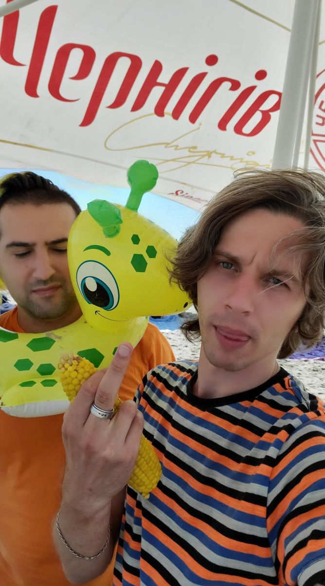

# Ivan / green hair / Danube

Ivan is the steady, low-key presence who balances out my high-octane ideas and chaos. We met in 2008 in a college apartment. We bonded over heavy music even though he was a goth and lost a bet. Nearly two decades later we still have each other's backs. That is rare.

He got his parents safely out of the Donetsk region to Balta. Both of us have roots in the East. Hearing that a close friend is safe and alive carries a whole different weight.

That road trip with the green hair is iconic. I was fresh off getting fired from HackerNoon. I was in a bad mood. Suddenly I was riding toward the Danube Delta with Ivan, his friends, and bright green hair. Peak life happening while I was making plans.

Kiliya and that spot where the Danube spills into the Black Sea is magic. We stood at the edge of a restricted nature reserve. We watched pelicans take off over the water. It is about as far from drone strikes, military logistics, and heavy stress as a human being can get.

I am keeping that pelican spot at the top of the bucket list. When the noise dies down, that water will still be waiting for me and Ivan. We will kick back, talk tech, and complain about playlists. 🌊🇺🇦

## Images

