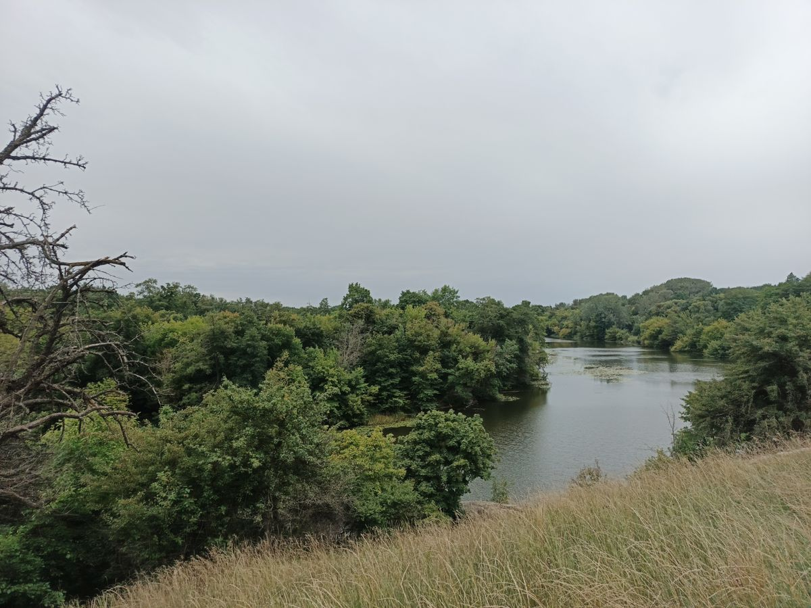
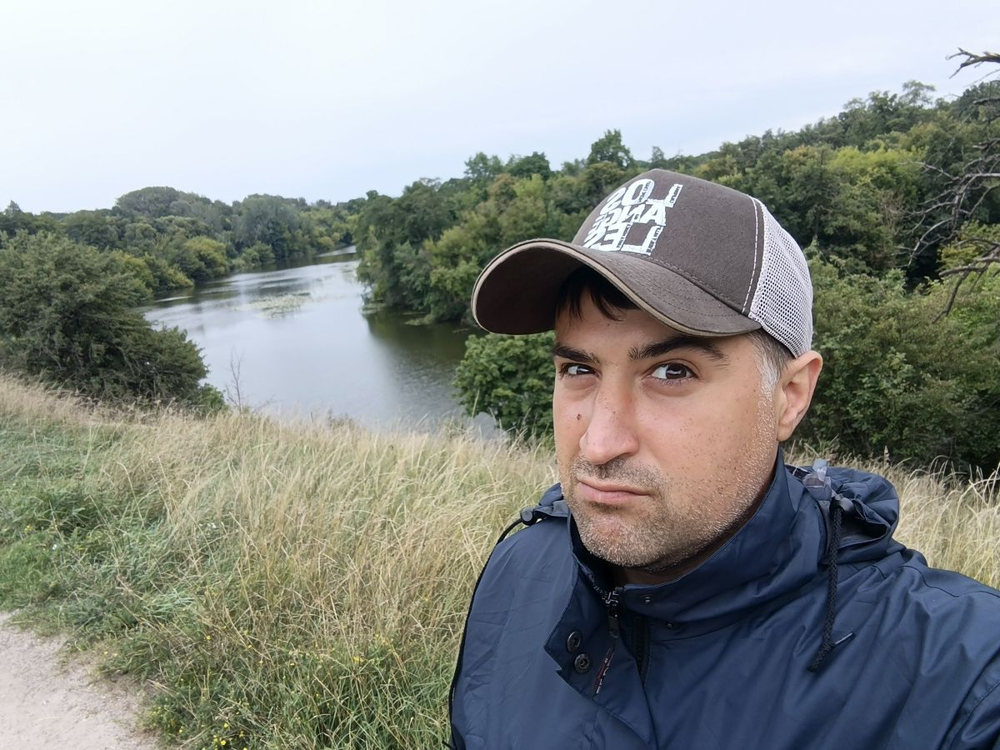

# The river ridge (short version)

During certification, I found one small way to clear my head: rent a bike and ride toward the river.

The trail led up to a ridge, shaded by trees, with a wide view over the water. 
It was quiet there—quiet enough to forget, for a little while, how heavy everything else felt.

The land has a long memory. 
Those bluffs had once been useful to Cossacks watching the river: high ground, cover, and a clear view of the fastest route toward the city.
The same features that made the ridge strategically important also make it a beautiful place to stop and catch your breath.

I’d ride out, stand at the overlook, and watch the river move below.
It’s a strange feeling, being somewhere that has seen so much conflict and finding it peaceful again.

For a little while, the ridge was just a place to breathe.

## Images

