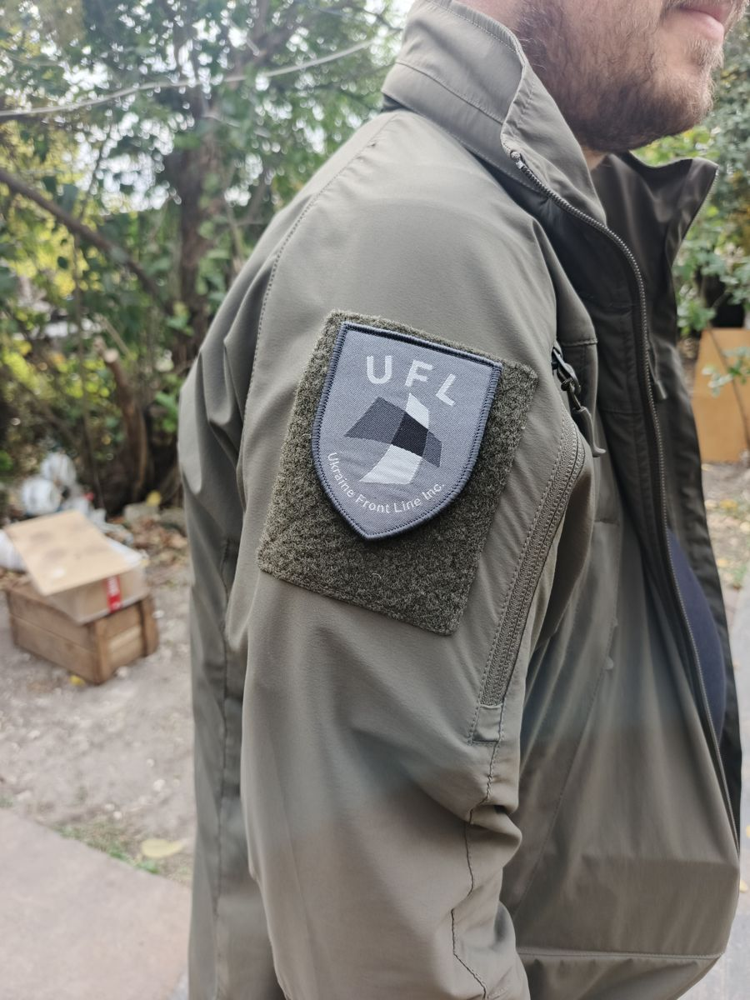

# The patch (short version)

A patch on a technician’s sleeve can carry more meaning than you’d expect.

When care packages arrived from across the ocean (ok ok ok - from a Germany), they weren’t just supplies. They were a reminder that people far away were thinking about us—and practical help at a time when it mattered. Good cold-weather gear, tourniquets, and solid clothing made a real difference.

The gear didn’t sit around for long. It went straight to the guys in position, where it was needed.

I put the patch on our lead technician’s sleeve. That felt right. The technicians were the people keeping our vehicles running under difficult conditions, often with very little room to work and plenty of reasons not to be out in the open.

For him, the patch was a small mark of pride. For me, it was a reminder of the people who helped get useful things into the hands of the people who needed them.

## Images

