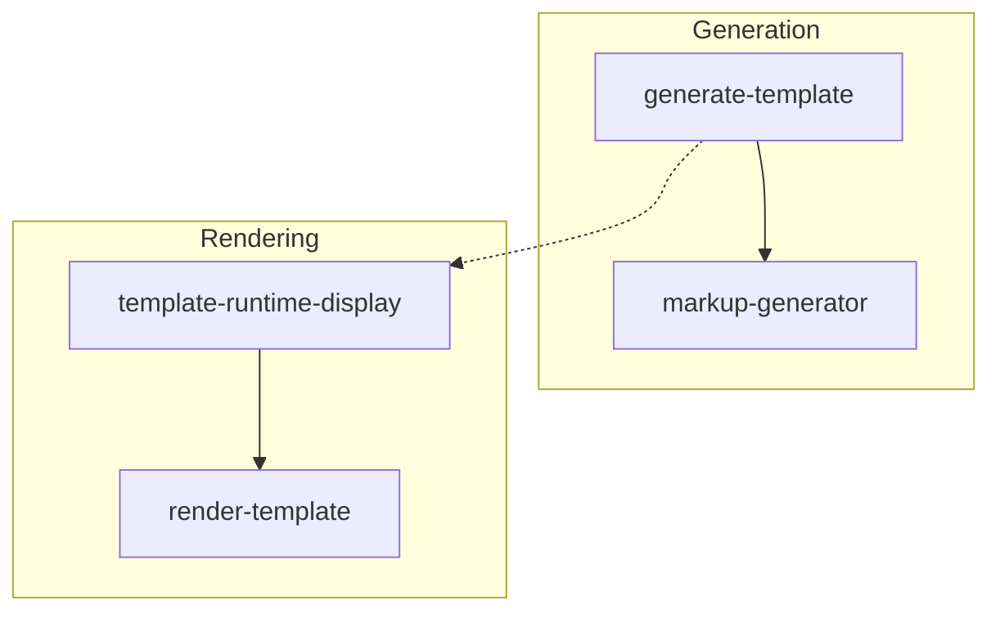

# The Front Door: Mapping a 75-Repository Ecosystem in One GitHub Org README

*Part of a series on the repositories behind LLazyEmail. This one is about the smallest repository we own and the first one most visitors see: the organization profile.*

---

## The problem: 75 repositories and no map

Open [github.com/LLazyEmail](https://github.com/LLazyEmail) and GitHub lists the repositories in order of last push. As of November 2026 there are 75 of them: 71 public (68 active and 3 archived) and 4 private. Four of the public ones are forks. The names give you some hints (`markdown-to-email`, `render-template`, `react-email-table`), but they do not tell you:

- which three repositories you need to generate an email today
- which packages are on npmjs and which are on GitHub Packages
- which repository owns file writes, and which one must never do I/O
- that two of the repositories are shared CI that every other repository calls
- which of the 30-odd starters and experiments are worth opening at all

For a long time the answer lived in the maintainer's head and in a README that was edited directly on GitHub a dozen times between 2022 and 2026. In November 2026 that README was rewritten into a proper front door. This article is about how that front door works, how it is structured, and what keeps it accurate.

## How the `.github` repository works

GitHub gives every organization a special repository named `.github`. Two of its features matter here:

1. **The profile README.** If the repository is public and contains `profile/README.md`, GitHub renders that file at the top of the organization's overview page. It is ordinary GitHub-flavored Markdown, with tables, Mermaid diagrams, badges and relative links.
2. **Default community health files.** Files such as `CONTRIBUTING.md`, `SECURITY.md`, issue templates and `FUNDING.yml` placed in the `.github` repository act as defaults for every repository in the organization that does not have its own.

[LLazyEmail/.github](https://github.com/LLazyEmail/.github) uses the first feature heavily and keeps the second in reserve. Its root holds only a short README, and the active repositories carry their own contributor files and `AGENTS.md`.

The repository itself is tiny: 31 commits, created on 28 April 2022. The layout:

```text
profile/README.md     the organization profile (534 lines)
docs/architecture.md  how the core repositories relate, with ownership rules
docs/repositories.md  the full categorized catalog of public repositories
docs/contributing.md  contribution, AGENTS.md, CI, changelog and package conventions
README.md             an 8-line pointer for people who open the repo itself
```

That split is the first design decision. The profile must be skimmable in under a minute; the supporting pages can be long. Everything in the profile links down to a deeper page, and every deeper page links back up.

## Designing for the first sixty seconds

The profile opens with five badges (two for the documentation site, one for the awesome-list star count, one for LinkedIn and a license overview) and one sentence:

> **Tools, templates, React components, reusable GitHub Actions, and curated lists for building emails** — write in Markdown or composable functions, get responsive HTML (or React email trees) out, and ship them through shared CI.

Below that is a **"Quick navigation" table** keyed by intent rather than by repository. It has 13 rows; here is an excerpt:

| I want to... | Go to |
| :--- | :--- |
| Start generating HTML today | Getting started |
| See how core repos connect | Architecture |
| Convert Markdown to email | Main project (markdown-to-email) |
| Install npm / GitHub Packages | npm packages |
| Adopt shared CI | CI & workflow conventions |
| Contribute or run an AI agent | Contributing · AGENTS.md |

Organizing by intent is the key move. A visitor rarely arrives wanting "the repository called `template-runtime-display`". They arrive wanting to render an email, find a React table component, or fix CI. The table turns 75 repository names into about a dozen jobs.

## A rendering gotcha: emoji headings and anchors

The profile's section headings start with an emoji (`## 🎯 What is LLazyEmail?`, `## 🏗 Architecture`), which makes the long page easier to scan. GitHub strips the emoji when it builds the heading anchor but keeps the space after it, which becomes a leading hyphen. The quick-navigation links therefore point at `#-what-is-llazyemail` and `#-architecture`, not `#what-is-llazyemail`. Get it wrong and the link silently scrolls nowhere. When you add a section, copy the anchor from the rendered page (hover over the heading and use the link icon) instead of guessing it.

## Getting started: four paths, real commands

The "Getting started" section offers lettered paths instead of one tutorial, because the ecosystem has two generations of tooling and both are in use:

- **A. New catalog-based generator (recommended for new templates).** Install `@llazyemail/generate-template` and `@llazyemail/template-runtime-display`, create a generator with `createGenerator`, and run `npx generate-template --list` or `--all --out=generated`.
- **B. Markdown → email (classic pipeline).** The original [markdown-to-email](https://github.com/LLazyEmail/markdown-to-email) engine.
- **C. Inspect a broken part.** Use the runtime's inspector to see which part of a template failed.
- **D. Render in CI on every PR.** A complete workflow snippet that uses the shared [email-template-workflows](https://github.com/LLazyEmail/email-template-workflows) action to render HTML, upload it as an artifact and comment on the PR.
- **E. Read the docs and lists.**

Every path ends in a command you can paste. A profile that only describes things is a brochure; one with runnable commands is documentation.

## One diagram for the core

The architecture section is a single Mermaid flowchart, rendered natively by GitHub. It groups the core repositories into five boxes (consumers, generation, rendering, the Markdown path, and shared Actions) and draws the dependency edges:



(That is a trimmed copy. The real diagram also shows four consumer template repositories, markdown-to-email and both shared CI repositories.)

The diagram alone is not enough. Under it sits the most useful table in the whole profile, the **ownership rules**:

| Package | Owns | Does not own |
| --- | --- | --- |
| `markup-generator` | Disk writes, filenames, read helpers | Template content |
| `@llazyemail/generate-template` | Catalog, payloads, `run` / `writeAll`, CLI | Part compose / email chrome |
| `@llazyemail/render-template` | Ordered parts + compose + traces | Catalog / file I/O |
| `@llazyemail/template-runtime-display` | Email shell, inspector, quality helpers | Generation catalog |
| `email-template-workflows` | CI install → render → artifact → comment | Your template source |
| `markdown-to-email` | Markdown syntax → HTML / React layouts | Modern catalog CLI |

The "does not own" column is what makes it work. In a multi-repository ecosystem the most common architectural mistake is quiet duplication: a template repository that grows its own little build pipeline because nobody told it one already exists. The profile says it explicitly: consumers **inject** `render` functions into `createGenerator` rather than reimplementing validation and write pipelines. The same rule appears in each repository's own `AGENTS.md`, so contributors and AI agents meet it in both places.

## The catalog: every public repository, categorized

The profile's "Repository index" covers the main groups in short tables. The full list lives in `docs/repositories.md`, which has twelve sections:

- Core pipeline
- Markdown tooling
- Production templates
- Documentation & curated lists
- React design system
- Remix / brand starters
- Starters, editors & utilities
- Experiments & sandboxes
- Forks
- Other active repositories
- Archived / legacy
- Notes

Each row has the repository link, its GitHub description, primary language, star count and a notes column.

Categorizing roughly 70 public repositories forces useful decisions. "Experiments & sandboxes" is an honest label that tells visitors not to build on something. "Archived / legacy" keeps old work discoverable without implying it is maintained. Forks are marked as forks.

The page header states the sourcing rule: the inventory is generated from `gh repo list` metadata and each repository's README, and star counts and archive flags come from the GitHub API ("do not invent stats"). The profile's closing section adds the tiebreaker: if something drifts, prefer the source repository.

## Packages: two registries, one table each

LLazyEmail publishes to two registries, and confusing them is the most common install failure. So the profile has a dedicated section with two tables:

- **npmjs.com (public):** `markup-generator`, `markdown-regex`, `@lazyemail/markdown-to-email`, `email-template-object`.
- **GitHub Packages (`@llazyemail` scope):** `generate-template`, `template-runtime-display`, `render-template`, `validator`, and one more org package. These need a token with `read:packages` and an `.npmrc` scope mapping.

Notice the near-collision: `@lazyemail` (one "l", on npmjs) versus `@llazyemail` (two, on GitHub Packages). A table that puts them side by side prevents a whole category of "package not found" issues.

Every version in those tables is labelled "approx." with a note to confirm with `npm view` before pinning. Version numbers are the fastest-rotting fact in any README, and saying so is cheaper than pretending otherwise.

## Conventions for humans and AI agents

The last third of the profile is conventions, and it is written with AI coding agents in mind, because much of the organization's maintenance work is now done with them:

- **Contributing:** small single-purpose draft PRs; extend, annotate or archive rather than delete; a standard `Co-authored-by` trailer when working for the maintainer; never commit secrets.
- **Shared CI:** prefer thin callers of `documentation-actions` (docs sites and awesome lists) and `email-template-workflows` (email rendering) over copying job YAML; pin third-party actions to a full commit SHA with a version comment, and let Renovate update them.
- **Release flows:** a table of the three patterns in use (`.changelog/` fragments with a release PR, Changesets with a Version Packages PR, and GitHub Release plus a publish workflow), with a rule not to hand-edit generated changelogs.
- **AGENTS.md:** most active repositories ship one, and agents should read it first. Org-wide expectations include "treat `src/` and tests as ground truth", "parts passed to render-template must return strings", and "never merge or close unless the human owner asks". Many repositories also expose `llms.txt` / `llms-full.txt`.

Putting these rules on the organization page does two things. It gives a newcomer the house style before they open their first PR, and it gives an AI agent one canonical place to read the cross-repository rules that no single repository's `AGENTS.md` can state on its own.

## Keeping the front door accurate

A profile like this is only valuable while it is true, and it starts going stale the day it merges. A refresh audit in November 2026, two weeks after the rewrite, found four kinds of drift, which make a good checklist:

1. **Pinned versions of shared Actions** (fix proposed in [PR #4](https://github.com/LLazyEmail/.github/pull/4)). The profile told readers to pin `documentation-actions@v1` "after release" and `email-template-workflows@v1`. By then documentation-actions had released v2.0.0, with short workflow names as the preferred surface and the long names deprecated until v3, and email-template-workflows was on v3, with v2 kept for the old email-specific defaults. Copy-paste examples in a profile are the ones people actually use, so stale pins spread.
2. **Missing repositories.** Comparing `gh repo list LLazyEmail` against the catalog showed exactly one public, non-archived repository missing everywhere: `generate-template-server`, a thin HTTP server around `generate-template` for the online editor, preview and zip downloads. Its catalog row and ownership-table line are proposed in [.github PR #4](https://github.com/LLazyEmail/.github/pull/4): it owns the HTTP surface over `run()` (`/render`, `/render-preview`, `/render-many` as a zip, auth and metrics) and does not own generation logic.
3. **Silently broken Markdown.** Every catalog table had five cells per row under a four-column header. GitHub renders that without complaint and simply drops the extra cell, which was the one that said `· fork` for the two forked documentation sites. The proposed fix (same PR) is a "Notes" header column. Nothing visibly broke, and information still disappeared.
4. **Numbers that move.** Star counts and package versions drift constantly. The profile labels versions as approximate, and the catalog stamps its numbers as taken "at documentation time". Even the catalog's headline count ("Public repos listed: 74") no longer matches the API's 71 public repositories, which shows how quickly totals go stale.

A few practices help:

- **Generate what you can.** Repository lists, descriptions, languages and archive status all come from the GitHub API (`gh repo list --json name,description,isArchived,isFork,primaryLanguage`). A script that diffs the API against the catalog catches missing and archived repositories in seconds.
- **Link instead of copying.** Where the profile mentions a workflow name or a config value, linking to the source file means a reader can verify it with one click.
- **Prefer small refresh PRs.** A profile refresh touches one concern (pins, a missing repository, a table fix), which keeps the review quick.
- **Extend, do not rewrite.** The profile ends with a note asking contributors to send a draft PR that extends sections rather than deleting them. Old sections such as "Learning resources", including Arthur's own articles, carry context that a rewrite would lose.

## What the profile does not do

It is worth listing the non-goals, because they kept the profile focused:

- It does not duplicate each repository's README. It links to it.
- It does not try to be the product documentation. That lives at [docs.llazyemail.com](https://docs.llazyemail.com), built from the separate documentation repository.
- It does not list private repositories, and it does not describe internal operations.
- It does not hide experiments. It labels them.

## Design decisions, summarized

| Decision | Why | Trade-off |
| --- | --- | --- |
| Short profile + deep `docs/` pages | Skimmable front page, room for detail | Two places to keep in sync |
| Quick navigation by intent | Visitors come with jobs, not repo names | Needs updating when jobs change |
| Lettered getting-started paths | Two tool generations in active use | Slightly longer section |
| Mermaid diagram + ownership table | Shows edges *and* boundaries | Diagram is hand-maintained |
| Two registry tables | Prevents `@lazyemail` / `@llazyemail` confusion | Versions go stale; labelled approximate |
| Conventions on the org page | One place for cross-repo rules (humans and agents) | Must match each repo's `AGENTS.md` |
| Facts from metadata; source repo wins | Clear rule when they disagree | Requires periodic refresh |

## Lessons learned

1. **Organize the front page by intent.** "I want to…" beats an alphabetical list of repositories.
2. **Write down what each repository does not own.** Boundaries prevent duplication better than diagrams do.
3. **Put runnable commands on the front page.** Every path should end in something you can paste.
4. **Copy-paste examples rot fastest.** Version pins in snippets need the most frequent checks.
5. **Validate your tables.** GitHub will not tell you that it dropped a cell.
6. **Diff the catalog against the API.** Missing repositories are a query away.
7. **Say how fresh a number is.** "Approx. version, confirm with `npm view`" is honest and cheap.
8. **Treat AI agents as readers.** Cross-repository rules belong somewhere every agent will look, and the organization profile is that place.

## See it

The profile is live at [github.com/LLazyEmail](https://github.com/LLazyEmail), and its source is [LLazyEmail/.github](https://github.com/LLazyEmail/.github). If your organization has more than a handful of repositories, it is worth an afternoon: write the quick-navigation table first, then the ownership table. Everything else is detail.
